# Microservices Reliability Project

> **Portfolio Engineering Artifact**: A production-grade demonstration of service decoupling, Docker internal networking, distributed failure containment, Prometheus & cAdvisor observability, and automated integration testing.

---

## 1. Project Overview

The **Microservices Reliability Project** models the architectural migration of an illustrative centralized application into **four independently deployable, bounded microservices**. The project was specifically designed to explore real-world challenges inherent in distributed systems:
- Network boundaries and service isolation.
- Cascading failure prevention using finite socket timeouts and circuit breakers.
- Observability distinction between application metrics and container resource utilization.
- Strict automated integration verification without fragile mocks.

---

## 2. Engineering Objectives

1. **Service Decomposition**: Establish clear, cohesive boundaries across presentation, ingress routing, asynchronous execution, and state caching.
2. **Deterministic Inter-Service Communication**: Rely strictly on Docker internal DNS service resolution (`http://api-gateway:8000`, `http://backend-worker:8001`, etc.) without hardcoded IPs or `localhost`.
3. **Failure Isolation & Graceful Degradation**: Ensure a partial failure (e.g., cache eviction, worker delay, or temporary network partition) produces a structured, actionable error rather than cascading unhandled socket exceptions.
4. **Full-Spectrum Observability**: Instrument all four services with standard Prometheus `/metrics` endpoints and scrape container kernel resource usage via cAdvisor.
5. **Executable Verification**: Deliver automated integration tests executed against real HTTP network sockets, verifiable in local environments and GitHub Actions CI.

---

## 3. Illustrative Monolithic Baseline

To provide an authentic architectural baseline, consider a hypothetical **legacy monolith** where web presentation, request routing, text processing, and in-process cache dictionaries coexisted within a single unified process.

### Baseline Limitations:
1. **Shared Failure Domain**: An out-of-memory (OOM) error or CPU spike caused by heavy background text analysis brought down the entire user-facing web server.
2. **Coupled Deployment Cycles**: A small CSS or template change in the frontend required rebuilding and re-testing the CPU-intensive processing engine.
3. **Resource Contention**: The in-process caching dictionary competed for heap space with the compute pipeline, leading to non-deterministic Garbage Collection pauses.
4. **Zero Independent Scalability**: The entire monolithic application had to be scaled horizontally as a unit, wasting memory on nodes that only needed compute capacity.

```mermaid
flowchart TD
    subgraph LegacyMonolith ["Illustrative Monolith (Single Process Failure Domain)"]
        UI[Web UI Module]
        Route[Routing & Validation Module]
        Worker[Text Analysis Engine]
        MemoryCache[In-Process Memory Cache Dict]
        
        UI --> Route
        Route --> Worker
        Worker --> MemoryCache
    end
    
    Client([Browser / Client]) -->|HTTP :5000| UI
    
    style LegacyMonolith fill:#2d1b1b,stroke:#ef4444,stroke-width:2px;
    style UI fill:#374151,stroke:#6b7280;
    style Route fill:#374151,stroke:#6b7280;
    style Worker fill:#374151,stroke:#6b7280;
    style MemoryCache fill:#374151,stroke:#6b7280;
```



---

## 4. Monolith-to-Microservices Migration Rationale

The migration isolates the four core responsibilities into independently versioned and containerized services:

```mermaid
flowchart LR
    Client([Client / Browser])
    
    subgraph ExternalAccess ["Edge Layer"]
        Frontend["frontend-service<br/>(Port :8080)"]
        Gateway["api-gateway<br/>(Port :8000)"]
    end
    
    subgraph InternalServices ["Internal Docker Network (microservices-net)"]
        Worker["backend-worker<br/>(Port :8001)"]
        Cache["data-cache-store<br/>(Port :8002)"]
    end
    
    subgraph Observability ["Telemetry & Monitoring"]
        Prometheus["Prometheus Server<br/>(Port :9090)"]
        cAdvisor["cAdvisor<br/>(Port :8085)"]
    end
    
    Client -->|HTTP GET /| Frontend
    Client -->|HTTP /api/*| Gateway
    Frontend -->|Internal HTTP| Gateway
    Gateway -->|Internal HTTP| Worker
    Worker -->|Internal HTTP| Cache
    
    Prometheus -.->|Scrape /metrics| Frontend
    Prometheus -.->|Scrape /metrics| Gateway
    Prometheus -.->|Scrape /metrics| Worker
    Prometheus -.->|Scrape /metrics| Cache
    Prometheus -.->|Scrape Container Stats| cAdvisor

    classDef pub fill:#1e293b,stroke:#38bdf8,stroke-width:2px;
    classDef priv fill:#0f172a,stroke:#34d399,stroke-width:2px;
    classDef obs fill:#1c1917,stroke:#f59e0b,stroke-width:2px;
    class Frontend,Gateway pub;
    class Worker,Cache priv;
    class Prometheus,cAdvisor obs;
```



### Architectural Benefits:
- **Independent Lifecycles**: The frontend team can iterate on UI presentation without touching worker runtime dependencies.
- **Fault Containment**: If `data-cache-store` crashes or is restarted, `backend-worker` logs the dependency failure, increments the `dependency_request_failures_total` Prometheus counter, and falls back to computation without throwing an unhandled exception.
- **Resource Optimization**: CPU-intensive text hashing and lexical analysis runs inside `backend-worker`, which can be scaled with container replicas without scaling the gateway.

---

## 5. Responsibilities of the Four Microservices

| Service Name | Network Role | Published Port | Internal Port | Primary Responsibilities |
| :--- | :--- | :--- | :--- | :--- |
| **`api-gateway`** | Ingress Boundary | `8000:8000` | `8000` | Request routing, payload schema validation, finite downstream timeouts (3.0s), circuit breaker pattern, sanitized JSON errors. |
| **`frontend-service`** | Presentation | `8080:8080` | `8080` | Serves dashboard UI, proxies user requests through `api-gateway`, displays service dependency health. |
| **`backend-worker`** | Processing | `8001:8001` | `8001` | In-memory job queue, SHA-256 fingerprinting, text token analysis, downstream cache lookup, degraded execution fallback. |
| **`data-cache-store`** | State Caching | `8002:8002` | `8002` | In-memory key-value storage, per-item TTL expiration, background eviction thread, cache hit/miss Prometheus counters. |

---

## 6. Service Dependency Mapping

```
Browser / Client
       │
       ▼
Frontend Service (Port 8080)
       │
       ▼
API Gateway (Port 8000)
       │
       ▼
Backend Worker (Port 8001)
       │
       ▼
Data Cache Store (Port 8002)
```

### Dependency Failure Matrix:
| Target Dependency | Calling Service | Failure Condition | Calling Service Behavior |
| :--- | :--- | :--- | :--- |
| `data-cache-store` | `backend-worker` | Connection refused / Timeout (2.0s) | Worker logs warning, increments `dependency_request_failures_total`, skips caching, completes job successfully in degraded state. |
| `backend-worker` | `api-gateway` | Downstream unavailable / Timeout (3.0s) | Gateway returns structured `503 Service Unavailable` or `504 Gateway Timeout` with JSON body. Tripping failure threshold transitions circuit breaker to `OPEN`. |
| `api-gateway` | `frontend-service` | Gateway unreachable | Frontend displays degraded status banner; user operations return structured error envelopes. |

---

## 7. Docker Networking & DNS Resolution

The services connect over a dedicated user-defined bridge network named `microservices-net`.

```yaml
networks:
  microservices-net:
    driver: bridge
```

### Docker DNS Rules Enforced:
1. Containers communicate via service names declared in `docker-compose.yml` (`http://backend-worker:8001`, `http://data-cache-store:8002`).
2. Containers **never** communicate over `localhost`. In containerized environments, `localhost` refers exclusively to the container's own loopback interface.
3. Every Dockerfile specifies explicit `HEALTHCHECK` instructions that probe the service's `/health` endpoint before dependent containers start.

---

## 8. Docker Compose Setup

### Quick Start:
```bash
# 1. Clone repository
git clone https://github.com/example/microservices-reliability-project.git
cd microservices-reliability-project

# 2. Build images and start all 6 containers (4 microservices + Prometheus + cAdvisor)
docker compose up --build -d

# 3. Verify health status of all running containers
docker compose ps

# 4. View real-time logs across services
docker compose logs -f api-gateway backend-worker

# 5. Clean teardown and network removal
docker compose down -v
```

---

## 9. API Endpoints Reference

### Public API Gateway Endpoints (`http://localhost:8000`)
- `GET /health`: Gateway health status and downstream circuit breaker states.
- `GET /metrics`: Prometheus metric exposition.
- `GET /api/status`: Aggregated health check querying worker and cache downstream services.
- `GET /api/jobs`: List recent background jobs.
- `POST /api/jobs`: Submit text payload for asynchronous analysis.
- `GET /api/jobs/<job_id>`: Query status and completed result of a specific job.
- `GET /api/cache/<key>`: Query cached key-value entry from cache store.
- `POST /api/cache`: Store key-value item with configurable TTL.

### Internal Microservice Ports (Scraped by Prometheus or accessed via Gateway)
- `frontend-service`: `http://frontend-service:8080/health`, `/metrics`, `/`
- `backend-worker`: `http://backend-worker:8001/health`, `/metrics`, `/jobs`
- `data-cache-store`: `http://data-cache-store:8002/health`, `/metrics`, `/cache`

---

## 10. Example Requests & Responses

### 1. Submit Job via API Gateway
```bash
curl -X POST http://localhost:8000/api/jobs \
  -H "Content-Type: application/json" \
  -d '{"payload": "Distributed reliability engineering", "simulate_delay": 0.2}'
```
**Response (HTTP 202 Accepted):**
```json
{
  "job_id": "job-a1b2c3d4e5f6",
  "status": "PENDING",
  "message": "Job accepted for processing",
  "poll_url": "/jobs/job-a1b2c3d4e5f6",
  "service": "backend-worker"
}
```

### 2. Poll Job Status
```bash
curl http://localhost:8000/api/jobs/job-a1b2c3d4e5f6
```
**Response (HTTP 200 OK):**
```json
{
  "job_id": "job-a1b2c3d4e5f6",
  "status": "COMPLETED",
  "job_type": "text_analysis",
  "duration_seconds": 0.2014,
  "cache_hit": false,
  "result": {
    "sha256": "4b9e28f...",
    "character_count": 37,
    "word_count": 3,
    "vowel_count": 13,
    "shannon_entropy": 3.7541,
    "processed_by": "backend-worker"
  }
}
```

### 3. Second Submission (Cache Hit)
Submitting identical payload returns instant completion with `"cache_hit": true`.

### 4. Downstream Failure Envelope (Simulated Dependency Failure)
```bash
curl -X POST http://localhost:8000/api/jobs \
  -H "Content-Type: application/json" \
  -d '{"payload": "Test", "force_fail": true}'
```
**Poll Response (HTTP 200 OK):**
```json
{
  "job_id": "job-f1e2d3c4b5a6",
  "status": "FAILED",
  "error": "Simulated worker processing failure induced by request parameter 'force_fail=true'"
}
```

---

## 11. Worker Processing Lifecycle & Queue Design

```
[POST /jobs] 
     │
     ▼
[JobManager.submit_job()] ──> In-memory thread-safe dictionary
     │
     ▼
[ThreadPoolExecutor] (Worker pool)
     │
     ├─► Step 1: Compute SHA-256 fingerprint
     ├─► Step 2: Query data-cache-store (GET /cache/<sha256>)
     │           ├─► Hit: populate result, set COMPLETED, return.
     │           └─► Miss: proceed to compute.
     ├─► Step 3: Run lexical analysis & Shannon entropy.
     ├─► Step 4: Write result to data-cache-store (POST /cache).
     │           └─► If cache fails: log warning, proceed without crashing.
     └─► Step 5: Update state to COMPLETED, record duration histogram.
```

> **Interview Architecture Note**: The worker queue is an in-memory `ThreadPoolExecutor` and Python dictionary. This is deliberate: it provides reproducible, zero-external-dependency local testing. In enterprise production, this queue would be replaced with a distributed message broker (e.g., Apache Kafka or RabbitMQ) to provide persistent offset tracking and horizontal consumer groups.

---

## 12. Cache Store Design

The `data-cache-store` implements an independent, lightweight HTTP key-value store:
- **Storage**: Python `threading.Lock` synchronized dictionary mapping keys to `CacheItem` objects.
- **TTL Mechanism**: Each item stores an absolute `expires_at` float timestamp.
- **Eviction Strategy**: Dual-mode:
  1. *Passive*: On every `get()` call, if `now >= expires_at`, the item is deleted and counted under `cache_evictions_total`.
  2. *Active*: A background daemon thread sweeps every 2.0 seconds to evict expired items, preventing memory leakage.
- **Trade-off Analysis vs Redis**:
  - *Lightweight HTTP Cache*: Zero external daemons required, 100% reproducible in lightweight containers, exposes native Prometheus metrics.
  - *Redis*: Better for multi-gigabyte sets, persistence snapshots (RDB/AOF), and clustered replication.

---

## 13. Reliability Engineering & Failure Handling

1. **Finite Timeouts**: All HTTP clients use strict finite timeouts (default 3.0s gateway-to-worker, 2.0s worker-to-cache). Threads never block indefinitely.
2. **Circuit Breakers**:
   - Implemented via `CircuitBreaker` in `services/common/http_client.py`.
   - Transitions from `CLOSED` to `OPEN` after 3 consecutive failures.
   - Rejects outbound requests immediately while `OPEN`, shielding troubled downstream services from stampeding load.
   - After an 8-second cooldown, enters `HALF_OPEN` to permit a single probe request.
3. **Structured Error Envelopes**: Prevents internal stack traces from leaking to clients. Errors always return JSON with `{"error": "...", "service": "...", "transient": true}`.
4. **Input Sanitization**: API Gateway rejects bodies missing `payload` or exceeding maximum size (256KB) with HTTP 400 or 413.

---

## 14. Observability: Application Metrics vs. Container Metrics

A critical distinction in production reliability engineering is separating **service-level application metrics** from **container-level infrastructure metrics**.

```
┌─────────────────────────────────────────────────────────────────┐
│                      PROMETHEUS (Port 9090)                     │
└────────────────┬───────────────────────────────┬────────────────┘
                 │ Scrapes /metrics              │ Scrapes cgroup stats
                 ▼                               ▼
┌───────────────────────────────────┐    ┌─────────────────────────┐
│     APPLICATION METRICS           │    │ CONTAINER KERNEL STATS  │
│  (api-gateway, frontend, worker,  │    │      (via cAdvisor)     │
│             cache)                │    │                         │
├───────────────────────────────────┤    ├─────────────────────────┤
│ • http_requests_total             │    │ • container_cpu_usage_  │
│ • http_request_duration_seconds   │    │   seconds_total         │
│ • jobs_processed_total            │    │ • container_memory_     │
│ • cache_hits_total / misses_total │    │   working_set_bytes     │
│ • dependency_failures_total       │    │ • container_network_    │
│ • circuit_breaker_state           │    │   transmit_bytes_total  │
└───────────────────────────────────┘    └─────────────────────────┘
```

---

## 15. Useful PromQL Queries

### Container Infrastructure Metrics (from cAdvisor):
```promql
# 1. Container CPU Usage (cores per container over 1m window)
sum(rate(container_cpu_usage_seconds_total{name=~".+"}[1m])) by (name)

# 2. Container Memory Working Set (in Megabytes)
sum(container_memory_working_set_bytes{name=~".+"}) by (name) / 1024 / 1024
```

### Application Service Metrics (from Service /metrics):
```promql
# 3. Overall HTTP Request Rate (requests per second by service)
sum(rate(http_requests_total[1m])) by (service, status)

# 4. HTTP 5xx Error Rate
sum(rate(http_requests_total{status=~"5.."}[1m])) / sum(rate(http_requests_total[1m]))

# 5. P95 Request Latency
histogram_quantile(0.95, sum(rate(http_request_duration_seconds_bucket[5m])) by (le))

# 6. Cache Hit Ratio
sum(rate(cache_hits_total[1m])) / (sum(rate(cache_hits_total[1m])) + sum(rate(cache_misses_total[1m])))

# 7. Downstream Dependency Failure Rate
sum(rate(dependency_request_failures_total[1m])) by (dependency)
```

---

## 16. Automated Integration Testing

The test suite runs real TCP/HTTP requests across live server threads without mocking.

### Executing Tests:
```bash
# Option A: Run using unittest (Zero pip dependencies required)
python3 -m unittest discover tests -v

# Option B: Run using pytest (when pytest is installed)
pytest -v tests/
```

### Test Coverage Highlights:
- `tests/test_integration.py`: Validates all 4 `/health` checks, gateway proxying, asynchronous job polling, cache hit bypass, and TTL expiration.
- `tests/test_reliability.py`: Tests payload validation rejections (400), unknown jobs (404), worker exception trapping (FAILED), circuit breaker state transitions, and concurrent job submissions.
- `tests/test_metrics.py`: Verifies Prometheus exposition syntax (`# HELP`, `# TYPE`) and counter increments across all services.

---

## 17. Environment Variables Reference

| Variable Name | Default Value | Target Service | Description |
| :--- | :--- | :--- | :--- |
| `PORT` | 8000 / 8080 / 8001 / 8002 | All | Server listen port |
| `HOST` | `0.0.0.0` | All | Bind host |
| `WORKER_SERVICE_URL`| `http://backend-worker:8001` | `api-gateway` | Internal URL for worker service |
| `CACHE_SERVICE_URL` | `http://data-cache-store:8002`| `api-gateway` | Internal URL for cache store |
| `DOWNSTREAM_TIMEOUT_SECONDS` | `3.0` | `api-gateway` | Max seconds before gateway aborts downstream request |
| `GATEWAY_URL` | `http://api-gateway:8000` | `frontend-service` | Internal URL for gateway |
| `CACHE_STORE_URL` | `http://data-cache-store:8002`| `backend-worker` | Internal URL for cache store |
| `WORKER_CONCURRENCY`| `4` | `backend-worker` | ThreadPool worker count |
| `JOB_CACHE_TTL_SECONDS` | `180` | `backend-worker` | TTL in seconds for completed job results |
| `DEFAULT_TTL_SECONDS` | `120` | `data-cache-store` | Default TTL for cached entries |

---

## 18. Complete Repository Tree

```
microservices-reliability-project/
├── .github/
│   └── workflows/
│       └── ci.yml               # GitHub Actions CI pipeline
├── monitoring/
│   └── prometheus/
│       └── prometheus.yml       # Prometheus scrape definitions
├── services/
│   ├── api_gateway/
│   │   ├── Dockerfile           # Gateway container definition
│   │   └── main.py              # Routing, circuit breaker, validation
│   ├── backend_worker/
│   │   ├── Dockerfile           # Worker container definition
│   │   └── main.py              # In-memory queue, compute, cache client
│   ├── common/
│   │   ├── __init__.py
│   │   ├── config.py            # Typed environment loader
│   │   ├── http_client.py       # Resilient HTTP client with CircuitBreaker
│   │   └── metrics.py           # Zero-dependency Prometheus exposition engine
│   ├── data_cache_store/
│   │   ├── Dockerfile           # Cache container definition
│   │   └── main.py              # In-memory key-value store with TTL
│   └── frontend_service/
│       ├── Dockerfile           # Frontend container definition
│       └── main.py              # Web dashboard & gateway proxy
├── tests/
│   ├── __init__.py
│   ├── harness.py               # Live multi-service TCP test harness
│   ├── test_integration.py     # End-to-end integration flows
│   ├── test_metrics.py         # Prometheus exposition validation
│   └── test_reliability.py     # Failure handling & circuit breaker tests
├── .dockerignore
├── .gitignore
├── docker-compose.yml           # 4 services + Prometheus + cAdvisor
├── requirements.txt             # Testing & linting dependencies
└── README.md                    # Engineering documentation
```

---

## 19. Known Limitations & Production Enhancements

1. **In-Memory Queue**: Worker jobs live in volatile RAM. A container restart drops active queued items. *Production enhancement*: Replace with RabbitMQ or Apache Kafka with durable message acknowledgments.
2. **Single-Node Cache**: The cache store does not cluster or replicate across availability zones. *Production enhancement*: Deploy a Redis Cluster or Amazon ElastiCache with multi-AZ failover.
3. **Distributed Tracing**: Currently, request correlation relies on HTTP status codes and structured logging. *Production enhancement*: Inject OpenTelemetry W3C `traceparent` headers across boundaries and export spans to Jaeger or Tempo.

---

## 20. Official Technical References

- [Docker Networking Overview](https://docs.docker.com/network/)
- [Docker Compose Specification](https://docs.docker.com/compose/compose-file/)
- [Prometheus Exposition Text Format](https://prometheus.io/docs/instrumenting/exposition_formats/)
- [cAdvisor Container Metrics](https://github.com/google/cadvisor)
- [The Twelve-Factor App (Processes, Concurrency, Disposability)](https://12factor.net/)
- [Martin Fowler: Circuit Breaker Pattern](https://martinfowler.com/bliki/CircuitBreaker.html)
