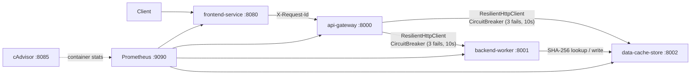
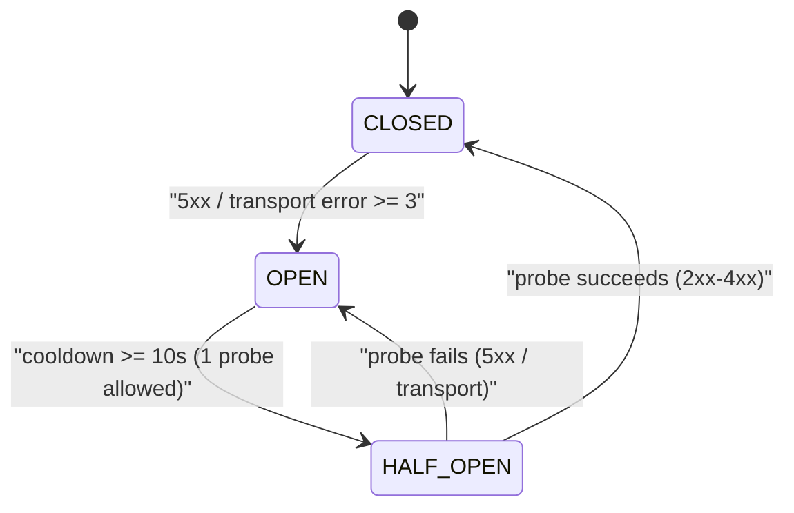

# Microservices Reliability Project

Four Python HTTP services (`frontend-service`, `api-gateway`, `backend-worker`, `data-cache-store`) wired together over Docker Compose with Prometheus and cAdvisor.

All four services use only the Python standard library (`http.server`, `urllib.request`, `threading`, `collections.OrderedDict`) so concurrency limits, timeouts, LRU eviction, and circuit-breaker state transitions live in plain code (`services/common/`) rather than third-party wrappers.

## Running the Stack

```bash
docker compose up --build
```

Exposed ports after startup:

| Service | Port | Purpose |
|---|---|---|
| `frontend-service` | `8080` | Web control panel (`/`), proxies `/api/*` to the gateway |
| `api-gateway` | `8000` | Aggregated health (`/api/status`), job/cache routing, circuit breakers |
| `backend-worker` | `8001` | `ThreadPoolExecutor` job queue with SHA-256 cache lookup |
| `data-cache-store` | `8002` | Thread-safe `OrderedDict` LRU cache with `time.monotonic()` TTL |
| `prometheus` | `9090` | Scrapes `/metrics` across all four services every `5s` |
| `cadvisor` | `8085` | Container CPU and memory stats (Linux hosts) |

## Fault-Injection Walkthrough

Once `docker compose up --build` is healthy, you can observe job deduplication, degraded health status, and circuit breaking directly from the terminal (or from the UI at `http://localhost:8080`):

1. **Submit a job and verify the SHA-256 cache hit on repeat:**

```bash
curl -s -X POST http://localhost:8000/api/jobs \
  -H "Content-Type: application/json" \
  -d '{"payload":"reliability smoke check","simulate_delay":0.1}'
```

Poll the returned `poll_url` (`GET http://localhost:8000/api/jobs/<job_id>`). Submitting the exact same `payload` again returns `cache_hit: true` from `data-cache-store` without re-running the worker computation.

2. **Force a worker failure vs. tripping the gateway circuit breaker:**

```bash
# Returns 202 and marks the job FAILED inside backend-worker (HTTP 200 on poll, does not trip gateway breaker)
curl -s -X POST http://localhost:8000/api/jobs \
  -H "Content-Type: application/json" \
  -d '{"payload":"forced failure test","force_fail":true}'

# Stop backend-worker to force 5xx transport failures at api-gateway
docker compose stop backend-worker

# Hit /api/status three times to reach failure_threshold=3
for i in 1 2 3; do curl -i -s http://localhost:8000/api/status | head -n 1; done
```

The first `/api/status` calls return `207 Multi-Status` showing `backend_worker` unreachable while `data_cache_store` stays `200`. After 3 failures, `GET http://localhost:8000/health` reports `downstream_circuits.backend-worker.state == "OPEN"`, and subsequent `POST /api/jobs` calls fail fast with `503` without waiting on socket timeouts.

3. **Recover with single-probe `HALF_OPEN`:**

```bash
docker compose start backend-worker
sleep 11
curl -s http://localhost:8000/api/status
curl -s http://localhost:8000/health
```

After the `10.0s` cooldown, the next request enters `HALF_OPEN` under `_probe_in_flight` while concurrent callers get `503` until that single probe succeeds and closes the circuit.

## Architecture & Reliability Mechanics





Key design details in `services/common/`:

- **4xx responses do not trip the breaker:** Validation errors or `404` responses count as normal protocol outcomes; only `>= 500` or socket/timeout errors increment `failure_count`.
- **Thread-cap load shedding:** `BoundedThreadingHTTPServer` uses `threading.BoundedSemaphore(64)` before spawning handler threads and answers `503` when full.
- **Monotonic clocks everywhere:** Both the breaker cooldown and cache TTL expiration (`TTL <= 0` rejected with `400`) read `time.monotonic()` rather than wall-clock `time.time()`.
- **Bounded memory:** `backend-worker` caps retained jobs at `MAX_RETAINED_JOBS` (`1000`) and `data-cache-store` caps entries at `MAX_CACHE_ENTRIES` (`10000`) using `OrderedDict` LRU eviction.

## Configuration

| Variable | Service | Default (Code / Compose) | Purpose |
|---|---|---|---|
| `DOWNSTREAM_TIMEOUT_SECONDS` | `api-gateway` | `3.0` | Timeout on gateway downstream calls |
| `GATEWAY_TIMEOUT_SECONDS` | `frontend-service` | `3.0` | Timeout on frontend proxy calls |
| `WORKER_CONCURRENCY` | `backend-worker` | `4` | `ThreadPoolExecutor` worker count |
| `MAX_RETAINED_JOBS` | `backend-worker` | `1000` | Max job records in `OrderedDict` |
| `JOB_CACHE_TTL_SECONDS` | `backend-worker` | `180` | TTL for cached SHA-256 job outputs |
| `DEFAULT_TTL_SECONDS` | `data-cache-store` | `120` (`180` in Compose) | Default cache TTL |
| `MAX_CACHE_ENTRIES` | `data-cache-store` | `10000` | LRU cache entry ceiling |

## Tests & Scope Notes

Run the 18 live-socket integration, metrics, and reliability tests locally (ephemeral ports via `tests/harness.py`):

```bash
pip install -r requirements.txt
pytest -v tests/
flake8 services tests --select=E9,F63,F7,F82 --show-source
```

`tests/test_integration.py` (5 tests), `tests/test_metrics.py` (3 tests), and `tests/test_reliability.py` (10 tests) cover end-to-end health aggregation, cache hits/TTL expiry, Prometheus `0.0.4` formatting, `CLOSED -> OPEN -> HALF_OPEN -> CLOSED` transitions, single-probe concurrency under `HALF_OPEN`, LRU eviction, and `503` load shedding past `64` concurrent connections. `.github/workflows/ci.yml` runs `compileall`, `flake8`, `pytest`, image builds, and a live `docker compose up -d --build` check.

Job records and cached payloads live only in process memory (cleared on restart), the worker queue runs inside a single container rather than an external broker, and the `cadvisor` service targets Linux Docker hosts due to `/dev/kmsg` and `/sys` mounts.
