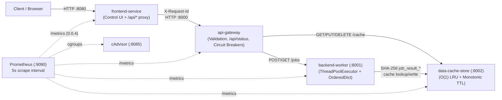
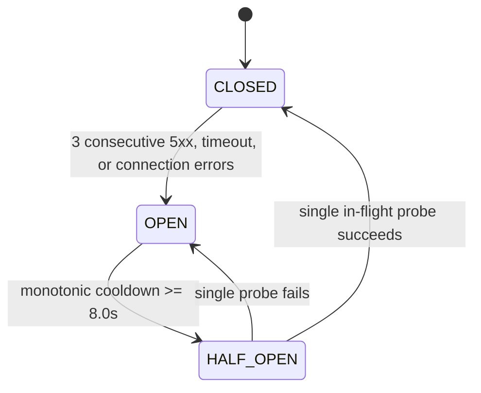

# Microservices Reliability Project

Four decoupled Python HTTP services communicating over a Docker bridge network, instrumented with Prometheus `/metrics` endpoints and cAdvisor container telemetry.

All four service runtimes (`services/*`) run strictly on the Python standard library (`http.server`, `urllib.request`, `threading`, `collections.OrderedDict`). Instead of wrapping third-party frameworks or metrics clients inside the containers, the bounded request server, single-probe circuit breaker, structured JSON logger, and Prometheus exposition registry (`services/common/`) are built directly so concurrency limits, timeouts, and failure transitions stay transparent.

---

## System Topology



Requests enter through `frontend-service` (or directly at `api-gateway`), carrying `X-Request-Id` across service boundaries. `api-gateway` exposes `GET /api/status` as an aggregated dependency probe (`1.5s` timeout per downstream health endpoint): it returns `200` when both `backend-worker` and `data-cache-store` are healthy, and `207` (`Multi-Status`) with per-dependency failure details when either downstream target is degraded.

---

## Circuit Breaking & Concurrency Control



`ResilientHttpClient` (`services/common/http_client.py`) isolates each downstream target behind its own `CircuitBreaker` (`failure_threshold=3`, `cooldown_seconds=8.0` via `time.monotonic()`). Only infrastructure faults—HTTP `5xx` responses, `URLError` (`503`), and `TimeoutError` (`504`)—advance `failure_count`. Downstream `4xx` responses such as `400` validation errors or `404` cache misses invoke `record_success()`, ensuring client mistakes cannot trip a healthy dependency.

When the cooldown expires, `allow_request()` transitions to `HALF_OPEN` and sets `_probe_in_flight = True` under a lock. Exactly one probe crosses to the downstream service while concurrent callers continue failing fast with `503` until that probe resolves.

Every HTTP server runs on `BoundedThreadingHTTPServer` (`services/common/http_server.py`), which guards `process_request()` with a non-blocking `threading.BoundedSemaphore(64)`. Once 64 requests are active, excess sockets receive `503 Service Unavailable` immediately (`Connection: close`) before allocating a new worker thread. On JSON ingress, `read_json_body()` inspects `Content-Length` upfront and rejects oversized payloads with `413` (`256,000` bytes on `api-gateway`, `500,000` bytes on `backend-worker`).

---

## Caching, Job Deduplication & Memory Bounds

`data-cache-store` implements an $O(1)$ thread-safe LRU store (`OrderedDict` with `move_to_end` on reads and `popitem(last=False)` when exceeding `MAX_CACHE_ENTRIES`). Item expiration relies on `time.monotonic()` so wall-clock adjustments cannot prematurely expire keys, pairing lazy eviction on `GET` with a background daemon sweeper thread.

`backend-worker` processes asynchronous text-analysis jobs inside a `ThreadPoolExecutor` (`WORKER_CONCURRENCY=4`), computes a SHA-256 hash of each payload, and checks `data-cache-store` under `job_result_<sha256>` before recomputing. Completed job metadata is capped in an `OrderedDict` (`MAX_RETAINED_JOBS=1000`), keeping container memory bounded under sustained traffic.

---

## Services & Endpoints

| Service | Host Port | Endpoints |
|---|---|---|
| `frontend-service` | `8080` | `GET /`, `GET/POST /api/*`, `GET /health`, `GET /metrics` |
| `api-gateway` | `8000` | `GET /api/status`, `GET/POST /api/jobs`, `GET /api/jobs/<id>`, `GET/POST/DELETE /api/cache/*`, `GET /health`, `GET /metrics` |
| `backend-worker` | `8001` | `GET/POST /jobs`, `GET /jobs/<id>`, `GET /health`, `GET /metrics` |
| `data-cache-store` | `8002` | `GET/POST/PUT/DELETE /cache`, `GET/PUT/DELETE /cache/<key>`, `GET /health`, `GET /metrics` |
| `prometheus` | `9090` | Scrapes all services + cAdvisor every `5s` (`24h` TSDB retention) |
| `cadvisor` | `8085` | Container CPU, memory, and cgroup metrics (Linux hosts) |

Each service exposes `http_requests_total` counters, `http_request_duration_seconds` histograms, and domain counters/gauges (such as `cache_hits_total`, `cache_misses_total`, `cache_evictions_total`, and `cache_keys_total`) in Prometheus `0.0.4` text exposition format, alongside JSON-formatted stdout logs.

---

## Configuration

Variables read through `services/common/config.py` (with `docker-compose.yml` overrides noted where applicable):

| Variable | Service | Code Default / Compose | Purpose |
|---|---|---|---|
| `DOWNSTREAM_TIMEOUT_SECONDS` | `api-gateway` | `3.0` | Timeout on gateway -> worker/cache calls |
| `GATEWAY_TIMEOUT_SECONDS` | `frontend-service` | `3.0` | Timeout on frontend proxy -> gateway calls |
| `WORKER_CONCURRENCY` | `backend-worker` | `4` | `ThreadPoolExecutor` worker threads |
| `MAX_RETAINED_JOBS` | `backend-worker` | `1000` | Job records kept in `OrderedDict` |
| `JOB_CACHE_TTL_SECONDS` | `backend-worker` | `180` | TTL written on cached SHA-256 job outputs |
| `DEFAULT_TTL_SECONDS` | `data-cache-store` | `120` (`180` in Compose) | Default TTL for cache entries |
| `MAX_CACHE_ENTRIES` | `data-cache-store` | `10000` | LRU capacity ceiling before eviction |

---

## Running Locally & Testing

Start the full 6-container stack:

```bash
docker compose up --build
```

Run the 18 live-socket integration, metrics, and reliability tests locally (`tests/harness.py` binds ephemeral real HTTP servers per suite):

```bash
pip install -r requirements.txt
pytest -v tests/
```

Or run directly with standard-library `unittest`:

```bash
python3 -m unittest discover -s tests -v
```

Syntax and static check:

```bash
flake8 services tests --select=E9,F63,F7,F82 --show-source
```

`tests/test_integration.py` (5 tests) covers service health, frontend-to-gateway aggregation, job lifecycle, SHA-256 cache hits, and TTL expiry. `tests/test_metrics.py` (3 tests) checks Prometheus `0.0.4` exposition across all four services and counter/label updates. `tests/test_reliability.py` (10 tests) verifies malformed/`413` handling, `404` unknown jobs, forced worker failures, full `CLOSED -> OPEN -> HALF_OPEN -> CLOSED` transitions, single-probe enforcement under concurrency during `HALF_OPEN`, unreachable downstream `503` responses, concurrent job bursts, negative TTL rejection, LRU eviction, and `BoundedThreadingHTTPServer` `503` rejection past `64` concurrent requests.

`.github/workflows/ci.yml` executes `compileall`, `flake8`, and `pytest -v tests/`, builds all four service images, and brings up `docker compose up -d --build` to verify healthy container startup in CI.

---

## Limitations

- **Volatile in-process state.** Job records (`backend-worker`) and cache entries (`data-cache-store`) live strictly in process memory and are lost on container restart.
- **Single-instance worker queue.** `ThreadPoolExecutor` queues jobs locally inside one worker process; horizontal worker scaling requires replacing the in-memory queue with an external broker such as RabbitMQ or Redis Streams.
- **Linux-specific cAdvisor mounts.** `cadvisor` in `docker-compose.yml` mounts `/`, `/var/run`, `/sys`, `/var/lib/docker/`, `/dev/disk/`, and `/dev/kmsg`, targeting Linux Docker hosts.
